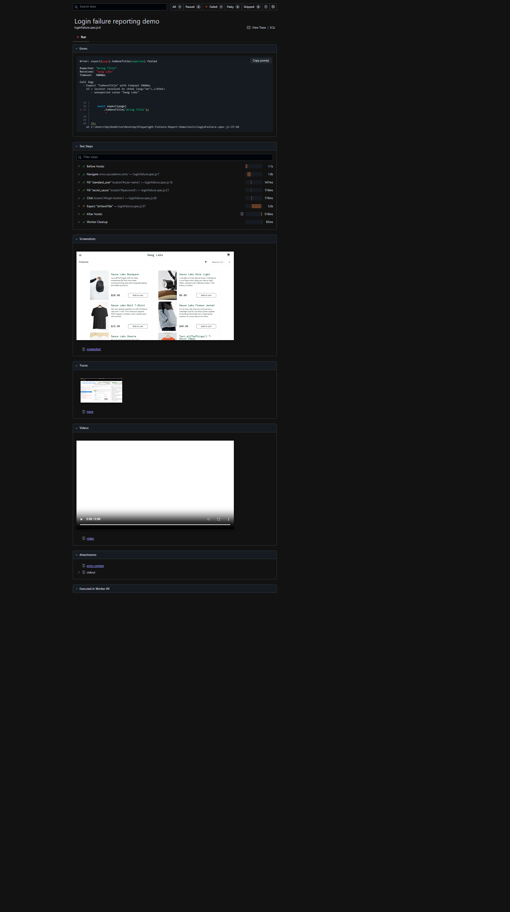
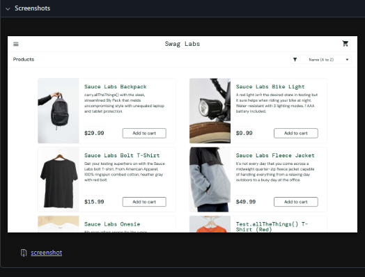
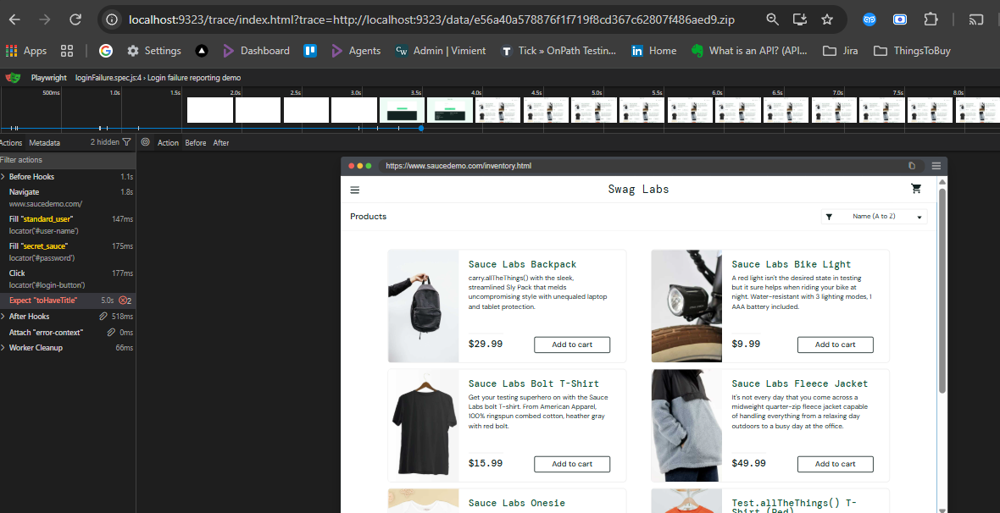

# Playwright Failure Report Demo

Test report with a **deliberate failure**. Shows how Playwright captures **trace**, **screenshot**, **video**, and **console log** in the HTML report — useful for client demos and debugging walkthroughs.

Target: [Sauce Demo](https://www.saucedemo.com) — login succeeds, then the test fails on an intentional wrong title assertion.

## What the failure report includes

| Artifact | Where in the report |
|---|---|
| Error + stack | Errors section (expected vs received title) |
| Test steps | Step timeline with durations |
| Screenshot | Page at failure (inventory after login) |
| Video | Full run recording |
| Trace | Playwright trace viewer (DOM, network, console) |
| Console log | Stdout attachment (`Opened login page`, etc.) |

<p align="center">
  
</p>

<p align="center"><em>HTML report overview — download the CI artifact or run <code>npm test</code> locally to regenerate.</em></p>

<details>
<summary>More evidence screenshots</summary>

<p align="center">
  
</p>

<p align="center">
  
</p>

</details>

## Prerequisites

- Node.js 18+
- npm

## Setup

```powershell
npm install
npx playwright install chromium
```

## Run locally

```powershell
npm test
npm run report
```

The test **is expected to fail** (`Expected: "Wrong Title"`, `Received: "Swag Labs"`). Open the HTML report to inspect trace, screenshot, video, and stdout.

## CI

GitHub Actions runs the suite on push/PR. The test fails by design; the workflow uses `continue-on-error` so the job completes and uploads artifacts.

| Artifact | Contents |
|---|---|
| `playwright-failure-report` | `playwright-report/` (HTML) + `test-results/` (trace zip, screenshots, video) |

Download the artifact from the Actions run → open `playwright-report/index.html` in a browser.

## Layout

```
tests/           loginFailure.spec.js — intentional assertion failure
evidence/        Static report screenshots for README / portfolio
playwright-report/   Generated HTML report (gitignored)
test-results/        Trace, screenshot, video per run (gitignored)
```

## Intentional failure

```javascript
await expect(page).toHaveTitle('Wrong Title');
```

Login works; the title check is wrong on purpose so the report demonstrates failure diagnostics.
